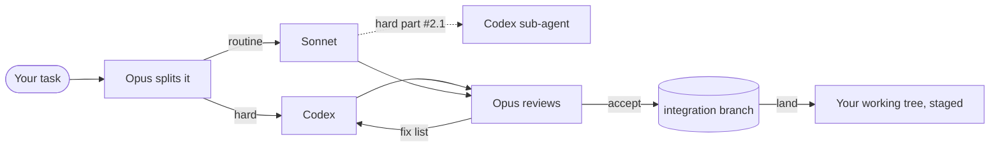

<div align="center">

# claude-orchestra

*Opus plans and reviews. Codex and Sonnet write the code. You watch it happen.*

[](https://code.claude.com/docs/en/plugins)


[](https://github.com/Yeachan-Heo/oh-my-claudecode)
[](LICENSE)

[Features](#features) • [Getting started](#getting-started) • [Usage](#usage) • [How it works](#how-it-works) • [Troubleshooting](#troubleshooting)

</div>

<p align="center">
  <picture>
    <source media="(prefers-color-scheme: dark)" srcset="docs/images/graph-dark.png">
    
  </picture>
</p>

A Claude Code plugin for big tasks on a limited Opus budget. Opus splits the task, gives the hard
parts to Codex (`gpt-6.1-sol`) and the routine parts to Sonnet, then reviews every result before
it reaches your code. Each subtask runs in its own git worktree, and a shared project memory stops
agents from reading the same files twice.

## Features

- **Work split by difficulty.** Bugs, refactors and cross-module logic go to Codex. Docs, formatting and tests that follow an existing pattern go to Sonnet. Independent subtasks run in parallel.
- **Opus reviews everything.** It reads each diff, runs the tests itself and sends work back with a numbered fix list. After two failed attempts it escalates: Sonnet to Codex, Codex to Opus.
- **One worktree per subtask.** Agents never share a checkout. Accepted work is merged into an integration branch and lands in your working tree as staged changes. Nothing is committed for you.
- **Shared memory.** Agents search project notes before reading code and save what they learn. A note is marked stale when the files it describes change.
- **Live board.** The status line shows every task with its executor, tokens and current command. The web graph shows the same data for all your active sessions.
- **No npm dependencies.** Node built-ins only, including `node:sqlite` for the memory.

## Getting started

### Prerequisites

| Tool | Version | Why |
|---|---|---|
| [Claude Code](https://code.claude.com) | 2.1.293+ for per-agent rows | runs the plugin |
| [Node.js](https://nodejs.org) | 20+, 22.13+ for the memory | runs the scripts |
| [Codex CLI](https://github.com/openai/codex) | 0.165.0+, logged in with `codex login` | runs Codex tasks |
| git | any | one worktree per subtask |

### Install

In Claude Code:

```
/plugin marketplace add Yeachan-Heo/oh-my-claudecode
/plugin marketplace add dimqsh/claude-orchestra
/plugin install orchestra@claude-orchestra
/orchestra:setup
```

Installing `orchestra` also installs `oh-my-claudecode`. `/orchestra:setup` checks Node and the
Codex CLI, shows the planned change to `~/.claude/settings.json` and installs the status line once
you confirm. Your current status line keeps working: its output comes first, the board below it.

> [!TIP]
> To hack on the plugin, add your local clone instead of the GitHub one:
> `/plugin marketplace add /path/to/claude-orchestra`.

## Usage

Give Opus a task:

```
/orchestra:orchestrate Fix the crash in sort_tasks when a task has no due date, add CSV export with tests, and update the README
```

What happens next:



While it runs, the status line looks like this:

```
◆ acme-shop  ⎇ feat/export  ·  Opus 18.2k · Codex 41.7k · Sonnet 14.0k  ·  Σ 73.9k · memory 12 · ≈9k saved
  tasks  ✓ 1 done   ◐ 2 running   ○ 1 queued
├─ ◐ #1 sort bug              Codex    24.1k   editing cli.py
├─ ✓ #2 export csv/json       Codex    17.6k   done · 2 attempts
├─ ◐ #4 export tests          Sonnet    9.8k   Bash pytest tests/
╰─ ○ #5 docstrings            Sonnet       —   waits on #2
```

Opus ends with a report: what was done, which commands it ran to check it, what went into memory
and what is left. The changes sit in your working tree, staged. Review them and commit.

### Commands

| Command | What it does |
|---|---|
| `/orchestra:orchestrate <task>` | Runs the whole flow above. Manual only, Claude never starts it by itself. |
| `/orchestra:board` | Opens the web graph at `http://127.0.0.1:7377/` and prints the board in chat. |
| `/orchestra:setup` | Checks requirements and installs or updates the status line. |

> [!NOTE]
> Tokens on the board exclude cache reads. For Claude they are input, cache writes and output; for
> Codex, uncached input plus output. "Saved" is an estimate of the file reading the memory spared.

## Shared memory

Notes about the project live in SQLite under `~/.claude/orchestra/kb/`, one database per
repository, shared by all its worktrees. Agents call the CLI themselves:

```
node "<plugin>/scripts/kb.mjs" search "task sorting"
node "<plugin>/scripts/kb.mjs" add --kind gotcha --title "..." --paths a.py,b.py --body "..."
node "<plugin>/scripts/kb.mjs" context
node "<plugin>/scripts/kb.mjs" stats
```

Search matches words and code identifiers (`sort tasks` finds `sort_tasks`), ranks with BM25 and
puts stale notes last. Codex does not call the CLI: `codex-task.mjs` adds a `## Project memory`
section to its prompt and saves the `## Findings` section of its answer.

## Worktrees and landing

Subtasks work in `<project>/.orchestra/worktrees/<id>` on branches named `orchestra/<name>/<id>`.
Commits happen only on those branches. `.orchestra/` and `.omc/` go to `.git/info/exclude`, so
they never reach your code.

| `worktree.mjs` | Effect |
|---|---|
| `init` | Creates the integration branch. Refuses if you have uncommitted changes, unless `--allow-dirty`. |
| `create <id>` | Branch and worktree for a subtask; `--from <id>` for a sub-task. |
| `diff <id>` | What the agent changed, including new files. |
| `accept <id>` | Commits the agent's work and merges it into the integration branch. A conflict aborts the merge and lists the files. |
| `refresh <id>` | Pulls the integration branch into the subtask; a conflict stays there for the agent. |
| `land` | `git merge --squash` into your working tree: staged, not committed. |
| `cleanup` | Removes the branches and worktrees; unmerged work only with `--force`. |

## Sub-agents

Claude Code agents cannot start other agents, so nesting goes one level deep and only to Codex.
A Sonnet agent hands a hard part to Codex as task `#2.1` with `codex-task.mjs --detach`, then
calls `codex-task.mjs wait <job>` until it finishes (exit code 3 means "still running"). This
keeps each call inside the 10-minute Bash limit. Opus reviews sub-tasks like any other task.

## How it works

- The task board is a JSON file in `~/.claude/orchestra/boards/`, written by `scripts/board.mjs`.
- Agents are tied to tasks by a `#<id>` label: in the agent description for Sonnet, on the first prompt line for Codex.
- Tokens and activity come from the Claude Code transcripts in `~/.claude/projects` and from the Codex job files in `~/.claude/orchestra/codex-jobs`. The plugin only reads the transcripts.
- Codex runs through `codex exec --json`. The runner reads its events for the current command and tails the rollout file for live token counts.
- The status line scripts are copied to `~/.claude/orchestra`, so they keep working when the plugin cache moves. A session-start hook keeps the copy current.
- The web server binds to `127.0.0.1` only and pushes updates over SSE. Open `?mock=1` for a demo without real sessions.
- Module boundaries and data formats are specified in [`docs/CONTRACT.md`](docs/CONTRACT.md).

### Configuration

| Setting | Where | Default |
|---|---|---|
| Codex model | `codexModel` in `~/.claude/orchestra/config.json` | `gpt-6.1-sol` |
| Graph port | `server.mjs --port` | `7377` |
| Active session window | `server.mjs --since <minutes>` | `30` |
| Plugin data folder | `ORCHESTRA_HOME` env var | `~/.claude/orchestra` |

## Troubleshooting

<details>
<summary>Codex says the model "is not supported when using Codex with a ChatGPT account"</summary>

The Codex CLI is too old for gpt-6.x models. Run `codex update` and check `codex --version`
(0.165.0 or newer).
</details>

<details>
<summary>Agents get "Permission denied" on Bash</summary>

Agents need Bash for `node` (memory, board) and for your test command. With strict settings, add
rules such as `Bash(node:*)` and `Bash(pytest:*)` to `permissions.allow`. Agents must use full
paths and no shell variables, or the rules won't match.
</details>

<details>
<summary>The memory command fails</summary>

The memory needs Node 22.13 or newer for `node:sqlite`. Check `node --version`. Everything else
works on Node 20.
</details>

<details>
<summary>No board in the status line</summary>

Run `/orchestra:setup`. Per-agent rows need Claude Code 2.1.293 or newer (`claude --version`).
</details>

## Uninstall

1. Restore your previous status line: `node "<plugin>/scripts/install-hud.mjs" uninstall`.
2. In each project that still has agent branches: `node "<plugin>/scripts/worktree.mjs" cleanup`.
3. Stop the graph: `node "<plugin>/web/server.mjs" --stop`.
4. Remove the plugin and unused dependencies: `/plugin uninstall orchestra@claude-orchestra`, then `claude plugin prune`.
5. Delete `~/.claude/orchestra` if you don't need the boards and memory.

`<plugin>` is `~/.claude/plugins/cache/claude-orchestra/orchestra/<version>`, or `plugins/orchestra`
in a local clone.

## Development

```
node --test test/
claude plugin validate . && claude plugin validate plugins/orchestra
```

Tests run against temporary `CLAUDE_CONFIG_DIR` and `ORCHESTRA_HOME` folders and never touch your
real `~/.claude`.
