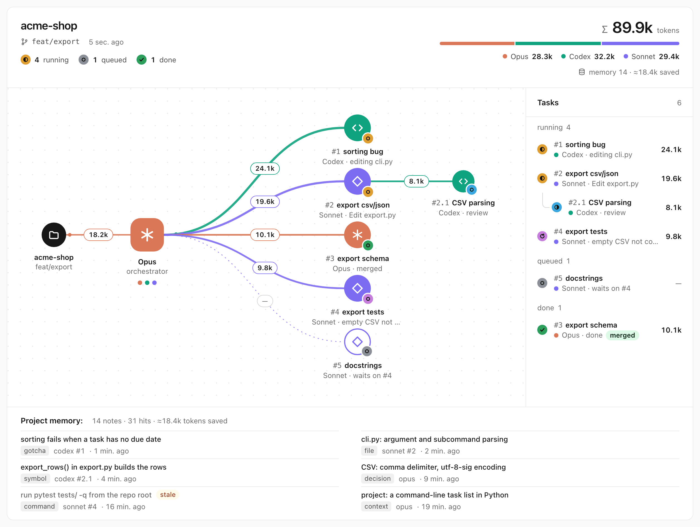
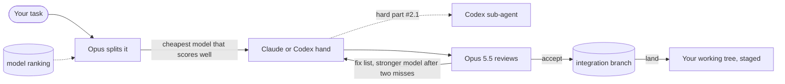

<div align="center">

# claude-orchestra

*Opus plans and reviews. The cheapest model that can do each job writes the code. You watch it happen.*

[](https://code.claude.com/docs/en/plugins)


[](https://github.com/Yeachan-Heo/oh-my-claudecode)
[](LICENSE)

[Features](#features) • [Getting started](#getting-started) • [Usage](#usage) • [Models and routing](#models-and-routing) • [How it works](#how-it-works) • [Troubleshooting](#troubleshooting)

</div>

<p align="center">
  <picture>
    <source media="(prefers-color-scheme: dark)" srcset="docs/images/graph-dark.png">
    
  </picture>
</p>

A Claude Code plugin for big tasks on a limited Opus budget. Opus splits the task, gives each
subtask to the cheapest model that scores well enough for its type (bug, logic, refactor, tests,
docs, search), then reviews every result before it reaches your code. Opus never edits code
itself. Each subtask runs in its own git worktree, and a shared project memory stops agents from
reading the same files twice.

## Features

- **Models picked per subtask.** The plugin finds the models you can use (Haiku and Sonnet as Claude agents, the GPT models your Codex CLI lists) and scores each one per task type from public benchmarks, its own six-task benchmark and your board history. Opus reads a short ranking, starts every subtask on the cheapest model within 85% of the best score (risky subtasks start higher) and writes a one-line reason for each choice into the plan. Independent subtasks run in parallel.
- **Opus reviews everything and edits nothing.** It reads each diff, checks that the hand touched only the files it was given, runs the tests itself and sends work back with a numbered fix list. After two failed attempts the subtask climbs to a stronger model; the last step is the strongest model at its top effort. The final review is always Opus 5.5.
- **One worktree per subtask.** Agents never share a checkout. Accepted work is merged into an integration branch and lands in your working tree as staged changes. Nothing is committed for you.
- **Shared memory.** Agents search project notes before reading code and save what they learn. A note is marked stale when the files it describes change.
- **Live board.** The status line shows every task with its model, effort, tokens and current command. The web graph shows the same data for all your active sessions. Every attempt is its own record, so a task that climbed to a stronger model keeps the failed attempts of the cheaper one.
- **No npm dependencies.** Node built-ins only, including `node:sqlite` for the memory.

## Getting started

### Prerequisites

| Tool | Version | Why |
|---|---|---|
| [Claude Code](https://code.claude.com) | 2.1.293+ for per-agent rows | runs the plugin |
| [Node.js](https://nodejs.org) | 20+, 22.13+ for the memory | runs the scripts |
| [Codex CLI](https://github.com/openai/codex) | 0.165.0+, logged in with `codex login` | runs Codex tasks |
| git | any | one worktree per subtask |
| [Artificial Analysis](https://artificialanalysis.ai) API key | optional, free | public coding scores and prices; with the own benchmark, it is what gives routing its evidence |

### Install

In Claude Code:

```
/plugin marketplace add Yeachan-Heo/oh-my-claudecode
/plugin marketplace add dimqsh/claude-orchestra
/plugin install orchestra@claude-orchestra
/orchestra:setup
```

Installing `orchestra` also installs `oh-my-claudecode`. `/orchestra:setup` checks Node and the
Codex CLI, shows the planned change to `~/.claude/settings.json` and installs the status line once
you confirm. Your current status line keeps working: its output comes first, the board below it.
Setup then finds your models, asks for the optional Artificial Analysis key, shows what the own
benchmark would cost and runs it only for the models you pick (none is fine).

> [!TIP]
> To hack on the plugin, add your local clone instead of the GitHub one:
> `/plugin marketplace add /path/to/claude-orchestra`.

## Usage

Give Opus a task:

```
/orchestra:orchestrate Fix the crash in sort_tasks when a task has no due date, add CSV export with tests, and update the README
```

What happens next:



While it runs, the status line looks like this:

```
◆ acme-shop  ⎇ feat/export  ·  Opus 18.2k · Codex 41.7k · Sonnet 14.0k  ·  Σ 73.9k · memory 12 · ≈9k saved
  tasks  ✓ 1 done   ◐ 2 running   ○ 1 queued
├─ ◐ #1 sort bug              6.1-sol@medium  24.1k   editing cli.py
├─ ✓ #2 export csv/json       6.1-sol@high    17.6k   done · 2 attempts
├─ ◐ #4 export tests          sonnet           9.8k   Bash pytest tests/
╰─ ○ #5 docstrings            haiku               —   waits on #2
```

Opus ends with a report: what was done, which commands it ran to check it, which model took which
subtask, what went into memory and what is left. The changes sit in your working tree, staged. Review them and commit.

### Commands

| Command | What it does |
|---|---|
| `/orchestra:orchestrate <task>` | Runs the whole flow above. Manual only, Claude never starts it by itself. |
| `/orchestra:board` | Opens the web graph at `http://127.0.0.1:7377/` and prints the board in chat. |
| `/orchestra:setup` | Checks requirements, installs or updates the status line, finds your models and offers the own benchmark. |

> [!NOTE]
> Tokens on the board exclude cache reads. For Claude they are input, cache writes and output; for
> Codex, uncached input plus output. "Saved" is an estimate of the file reading the memory spared.

## Models and routing

Opus does not guess which model fits a subtask. `scripts/models.mjs` keeps a catalog of the
models you can use in `~/.claude/orchestra/models.json` and prints a ranking at the start of every
run.

| Command | What it does |
|---|---|
| `models.mjs discover [--force]` | Lists the models you can use and sends one tiny request per new model to check access. Cached for 24 hours. |
| `models.mjs benchmarks [--force]` | Loads public scores and prices. Weekly, or when discovery finds a new model. |
| `models.mjs brief [--types a,b]` | Prints the ranking Opus reads: up to three rungs per task type, at most 20 lines. |
| `models.mjs bench --estimate` | Lists the models the own benchmark can run and its token cap. |
| `models.mjs bench --models a,b` | Runs the own benchmark for the models you name. |
| `models.mjs bench --skip a,b` | Marks models as not picked; they never run automatically. A model that already has benchmark results is kept (`kept (already benchmarked)`). |
| `models.mjs bench --new` | Benchmarks models nobody has run yet. The orchestrate skill starts it in the background after a run; it does nothing without `benchAuto: true`. |

An example of what `brief` prints (made-up numbers):

```
bug 1. claude:sonnet · 73 · own 2/2 · AA 59 (2026-10-28) · $$
bug 2. codex:gpt-5.6-terra@high · 79 · AA 79 (2026-10-28) · $$
bug 3. codex:gpt-6.1-sol@high · 83 · history 6 tasks, 83% first try · $$$
```

**Evidence.** Only models with evidence for a type are ranked: a public score on the primary
metric, or at least one own-benchmark or board task of that type. Without any, `brief` prints
`<type> no evidence yet` and one `untested:` line with the command that would test the models:

```
bug no evidence yet
logic no evidence yet
refactor no evidence yet
tests no evidence yet
docs no evidence yet
search no evidence yet
untested: claude:haiku, claude:sonnet, codex:gpt-5.6-terra, codex:gpt-6.1-sol (models.mjs bench --models claude:haiku,claude:sonnet,codex:gpt-5.6-terra,codex:gpt-6.1-sol)
Limits: claude unknown · codex unknown · gemini unknown · kimi unknown
```

For such a type Opus picks a hand from the untested models by its own judgment, marks it
`untested` in the plan and suggests `/orchestra:setup` or `bench` at the end of its report.

**Score.** Each model gets a score from 0 to 100 per task type. The prior is one public metric
per type, the one most candidates have (ties go to the Artificial Analysis coding index, then
SWE-bench, Terminal-Bench, LiveCodeBench). A model without it gets the median of the others, or
50 if there is none. The own benchmark and your board history pool into n tasks. With 5 or more
history tasks of that type, the history's first-try rate is the score. Below that, the score is
`(1 - w) * prior + w * pass rate` with `w = n / (n + 4)`.

**Cost class.** `$` to `$$$$`, from the Artificial Analysis price blended 3:1 input to output.
Without a price the class is the provider's default: Claude `$$`, Codex `$$$`, Gemini `$`, Kimi
`$$`. Without an Artificial Analysis key no model has a price, so every class is the provider's.

**Ladder.** Rung 1 is the cheapest candidate that scores at least 85% of the best, skipping
providers marked `low limit` (above 90% of any limit window). Rung 2 is the next candidate that
scores at least 5 points higher, or sits in a higher cost class and scores higher. Rung 3 is the
best score. Rung 1 runs at medium effort, rungs 2 and 3 at high (the nearest the model supports).
Opus starts a subtask at rung 1; a risky one starts higher. When a subtask fails, it climbs the
rungs, and the last step re-runs rung 3 at its top effort.

**Own benchmark.** Six tiny fixture repositories (bug, logic, refactor, tests, docs and a
multi-file change that counts as a second refactor sample) each have a hidden check script.
`search` has no fixture and relies on public data and history. A run is capped at 150k tokens
per model, checked between tasks, with a 10-minute timeout per task; a model that goes over is
flagged `overCap`. One run at a time (`bench.lock`). Claude models run through `claude -p`, Codex
models through `codex-task.mjs` (the exact flags are in [`docs/CONTRACT.md`](docs/CONTRACT.md)).
`bench --new` runs only with `benchAuto: true` and never runs models you skipped. It is
postponed while a board is active (not finished and updated in the last 30 minutes) or the
provider is above 70% of a limit window: the run stops, and the next `bench --new` picks up where
it left off. The orchestrate skill starts it in the background after each run and nothing else
starts it; it does nothing without `benchAuto` or new models.

**Providers.** Only providers with a runner, Claude and Codex, are ranked or listed. Claude:
`haiku` and `sonnet` through the `Agent` tool; `fable` only with `allowFable: true`; `opus` is the
brain and reviewer, never a hand. Codex: every model `codex debug models` lists. Gemini is
discovered, but its runner is deferred: the Gemini CLI rejects some account types
(`IneligibleTierError`, asks to migrate to Antigravity), so it is listed unavailable with that
error and never ranked. Kimi is listed `disabled: no sandbox` and never gets a task. No local
models run.

Public scores and prices come from [Artificial Analysis](https://artificialanalysis.ai), which
needs a free API key. The free key and the own benchmark are what give routing its evidence. The
keyless fallback, the BenchLM tables in the `leoncuhk/awesome-llm-bench` mirror, lists only the
top 10 models per benchmark; in a live test it held no coding score for any discovered model. Every public score in the catalog carries its source and date.

## Shared memory

Notes about the project live in SQLite under `~/.claude/orchestra/kb/`, one database per
repository, shared by all its worktrees. Agents call the CLI themselves:

```
node "<plugin>/scripts/kb.mjs" search "task sorting"
node "<plugin>/scripts/kb.mjs" add --kind gotcha --title "..." --paths a.py,b.py --body "..."
node "<plugin>/scripts/kb.mjs" context
node "<plugin>/scripts/kb.mjs" stats
```

Search matches words and code identifiers (`sort tasks` finds `sort_tasks`), ranks with BM25 and
puts stale notes last. Codex does not call the CLI: `codex-task.mjs` adds a `## Project memory`
section to its prompt and saves the `## Findings` section of its answer.

## Worktrees and landing

Subtasks work in `<project>/.orchestra/worktrees/<id>` on branches named `orchestra/<name>/<id>`.
Commits happen only on those branches. `.orchestra/` and `.omc/` go to `.git/info/exclude`, so
they never reach your code.

| `worktree.mjs` | Effect |
|---|---|
| `init` | Creates the integration branch. Refuses if you have uncommitted changes, unless `--allow-dirty`. |
| `create <id>` | Branch and worktree for a subtask; `--from <id>` for a sub-task. |
| `diff <id>` | What the agent changed, including new files. |
| `accept <id>` | Commits the agent's work and merges it into the integration branch. A conflict aborts the merge and lists the files. |
| `refresh <id>` | Pulls the integration branch into the subtask; a conflict stays there for the agent. |
| `land` | `git merge --squash` into your working tree: staged, not committed. |
| `cleanup` | Removes the branches and worktrees; unmerged work only with `--force`. |

## Sub-agents

Claude Code agents cannot start other agents, so nesting goes one level deep and only to Codex.
A Claude hand gets a sub-agent only when Opus allows it in the brief, and the brief names the
sub-agent's model and effort; a hand never picks a model. The hand starts Codex as task `#2.1`
with `codex-task.mjs --model <m> --effort <e> --detach`, then calls `codex-task.mjs wait <job>`
until it finishes (exit code 3 means "still running"). This keeps each call inside the 10-minute
Bash limit. Opus reviews sub-tasks like any other task.

## How it works

- The task board is a JSON file in `~/.claude/orchestra/boards/`, written by `scripts/board.mjs`. `board add <id> "<title>" --exec <provider> --model <model> --effort <effort> --type <type>` stores the choice. Each attempt is its own record (provider, model, effort, tokens, outcome: accepted, rework or failed), and the first-try rate per model and type feeds the scores.
- Agents are tied to tasks by a `#<id>` label: in the agent description for Claude hands, on the first prompt line for Codex.
- Tokens and activity come from the Claude Code transcripts in `~/.claude/projects` and from the job files in `~/.claude/orchestra/jobs`, which carry a `provider` field. Older Codex jobs in `~/.claude/orchestra/codex-jobs` are still read. The plugin only reads the transcripts.
- Codex runs through `codex exec --json`, with `--model` and `--effort` from the plan. The runner reads its events for the current command and tails the rollout file for live token counts.
- Limits: the status line writes Claude's 5-hour and weekly windows to `~/.claude/orchestra/limits.json` once a minute. Codex's come from the newest rollout file. Gemini and Kimi are unknown.
- The status line scripts are copied to `~/.claude/orchestra` together with `lib/` and `data/` (the model alias table and provider cost classes), so they keep working when the plugin cache moves. A session-start hook keeps the copy current.
- The web server binds to `127.0.0.1` only and pushes updates over SSE. Open `?mock=1` for a demo without real sessions.
- Module boundaries and data formats are specified in [`docs/CONTRACT.md`](docs/CONTRACT.md).

### Configuration

| Setting | Where | Default |
|---|---|---|
| Codex fallback model | `codexModel` in `~/.claude/orchestra/config.json`; used only when a run passes no `--model` | `gpt-6.1-sol` |
| Fable as a hand | `allowFable` in `config.json`. Fable costs more, so it stays off until you set `true` | `false` |
| Artificial Analysis key | `artificialAnalysisKey` in `config.json`, or the `ORCHESTRA_AA_KEY` env var (the env var wins) | none |
| Benchmark new models automatically | `benchAuto` in `config.json`; `/orchestra:setup` sets it to `true` | `false` |
| Graph port | `server.mjs --port` | `7377` |
| Active session window | `server.mjs --since <minutes>` | `30` |
| Plugin data folder | `ORCHESTRA_HOME` env var | `~/.claude/orchestra` |

A `config.json` that turns Fable on and keeps the automatic benchmark:

```json
{ "allowFable": true, "benchAuto": true }
```

Kimi stays off until it offers a sandbox: its headless `--print` mode approves every command on
the whole machine, so discovery lists it as `disabled: no sandbox` and it never gets a task.

Files in `~/.claude/orchestra`: `models.json` (the catalog), `limits.json`, `jobs/`, `boards/`,
`kb/`, `bench.lock` and `config.json`.

## Troubleshooting

<details>
<summary>Codex says the model "is not supported when using Codex with a ChatGPT account"</summary>

The Codex CLI is too old for gpt-6.x models. Run `codex update` and check `codex --version`
(0.165.0 or newer).
</details>

<details>
<summary>Agents get "Permission denied" on Bash</summary>

Agents need Bash for `node` (memory, board) and for your test command. With strict settings, add
rules such as `Bash(node:*)` and `Bash(pytest:*)` to `permissions.allow`. Agents must use full
paths and no shell variables, or the rules won't match.
</details>

<details>
<summary>The memory command fails</summary>

The memory needs Node 22.13 or newer for `node:sqlite`. Check `node --version`. Everything else
works on Node 20.
</details>

<details>
<summary>No board in the status line</summary>

Run `/orchestra:setup`. Per-agent rows need Claude Code 2.1.293 or newer (`claude --version`).
</details>

<details>
<summary>A model is missing from the ranking</summary>

Run `node "<plugin>/scripts/models.mjs" discover --force` and read the `unavailable:` line;
the catalog entry in `~/.claude/orchestra/models.json` holds the error. Fable needs
`allowFable: true`. Gemini and Kimi are never ranked and never get tasks (see Configuration and Models and routing).
Codex models appear only when `codex debug models` lists them.
</details>

<details>
<summary>The benchmark does not start</summary>

`bench already running` means another run holds `~/.claude/orchestra/bench.lock`. `bench --new`
needs `benchAuto: true`. It stops while a board is active or the provider is above 70% of a limit
window, and the next `bench --new` picks up where it left off. `bench --models <model>` forces a
run for one model.
</details>

## Uninstall

1. Restore your previous status line: `node "<plugin>/scripts/install-hud.mjs" uninstall`.
2. In each project that still has agent branches: `node "<plugin>/scripts/worktree.mjs" cleanup`.
3. Stop the graph: `node "<plugin>/web/server.mjs" --stop`.
4. Remove the plugin and unused dependencies: `/plugin uninstall orchestra@claude-orchestra`, then `claude plugin prune`.
5. Delete `~/.claude/orchestra` if you don't need the boards, memory and model catalog. It also holds your Artificial Analysis key if you stored one in `config.json`.

`<plugin>` is `~/.claude/plugins/cache/claude-orchestra/orchestra/<version>`, or `plugins/orchestra`
in a local clone.

## Development

```
node --test test/
claude plugin validate . && claude plugin validate plugins/orchestra
```

Tests run against temporary `CLAUDE_CONFIG_DIR` and `ORCHESTRA_HOME` folders and never touch your
real `~/.claude`.
